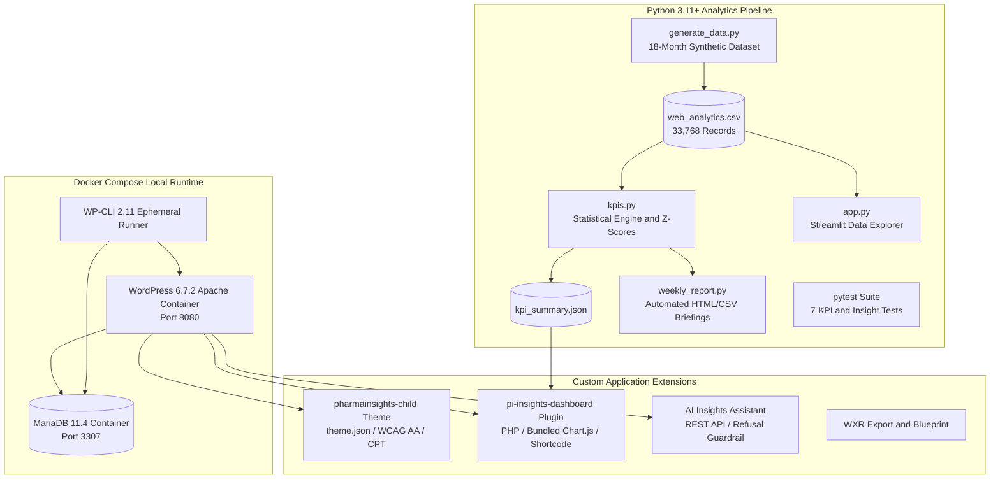
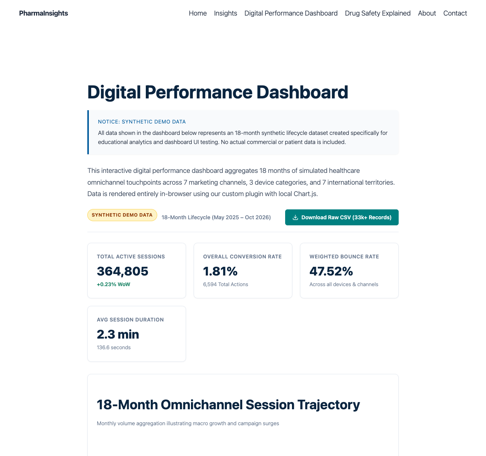
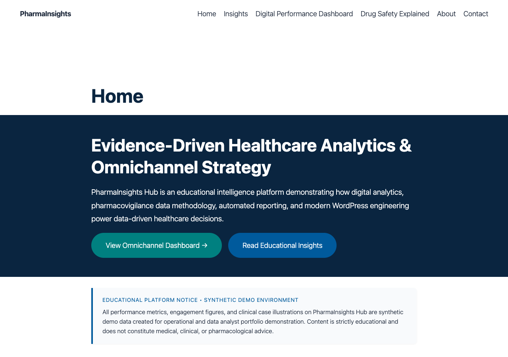
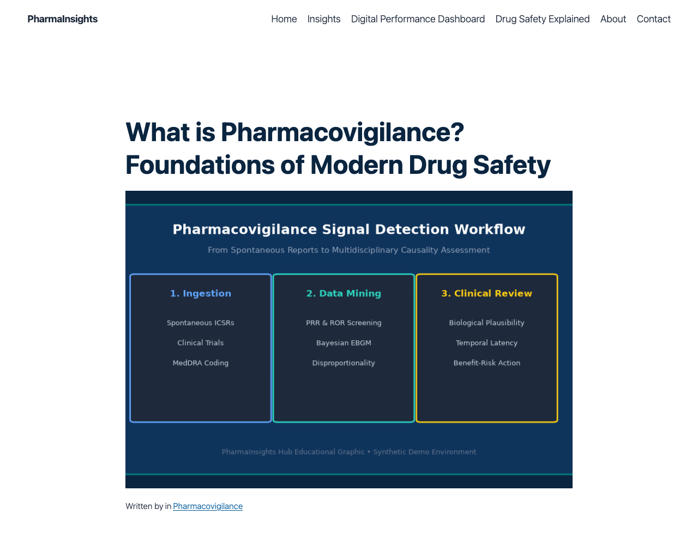
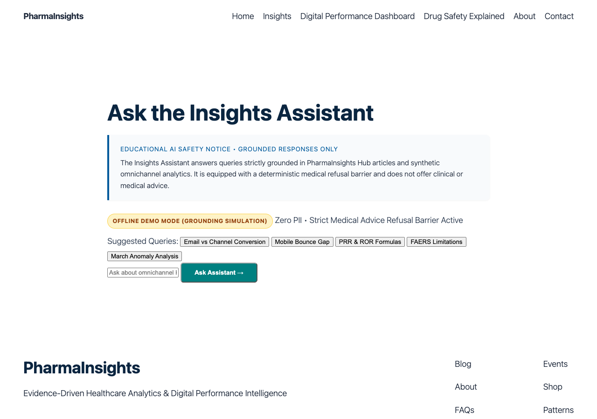

# PharmaInsights Hub

> Educational Omnichannel Analytics, Platform Engineering, and Reporting Automation  
> Digital and Data Solutions Portfolio for Life-Sciences Omnichannel Strategy

[](https://wordpress.org)
[](https://php.net)
[](https://mariadb.org)
[](https://python.org)
[](https://docker.com)
[](#6-verified-lighthouse-performance-and-accessibility-scores)
[](https://pytest.org)
[](LICENSE)

---

## 1. Executive Summary and Purpose

PharmaInsights Hub is an educational, fictional healthcare and life-sciences digital intelligence platform. Built from the ground up to embody the responsibilities of a Digital and Data Solutions Intern on a pharmaceutical Omnichannel Strategy team, this project bridges domain-specific health communications with full-stack data engineering, automated reporting, and enterprise Content Management System (CMS) platform administration.

The project demonstrates:
- Analyzing digital performance data across 7 channels, 3 devices, and 7 geographic markets.
- Developing interactive, locally bundled web dashboards and automated weekly executive briefings.
- Identifying and documenting concrete operational and technical process improvements.
- Implementing safe artificial intelligence initiatives with strict medical advice guardrails.
- Publishing structured, accessible, and search-optimized editorial content in WordPress.
- Administering, hardening, and maintaining containerized digital platforms for user experience and operational reliability.

---

## 2. Hard Constraints and Compliance Adherence

- Fictional Brand: All branding, titles, and nomenclature are fictional. No real pharmaceutical companies, proprietary product trademarks, or drug marketing claims are used.
- Synthetic Demo Data: All digital analytics records are synthetically generated and explicitly labeled as synthetic demo data on all public interfaces and export files.
- Educational Medical Disclaimer: Every healthcare article, insight summary, and interactive query carries a mandatory disclaimer: "Educational Content Only. Not Medical Advice."
- Originality and Copyright: All text content is original. Visual diagrams are custom-engineered vector illustrations and charts without copyrighted third-party assets.
- Zero Secret Leaks: Environment credentials reside in git-ignored `.env` files. Sanitized templates are tracked in `.env.example`.
- Verifiable Metrics: All test results, Lighthouse scores, and execution timings reflect actual benchmark outputs recorded by automated tooling on local runs.

---

## 3. Platform Architecture



---

## 4. Platform Visual Showcase

### Interactive Omnichannel Performance Dashboard

*Interactive multi-channel performance dashboard featuring 18-month trajectories, channel mix, device bounce discrepancy, and anomaly detection ledger.*

### Platform Home Page and Strategic Overview

*Evidence-driven home page featuring core competencies, executive calls to action, and accessible WCAG 2.1 AA design.*

### Educational Pharmacovigilance Article

*Structured educational article featuring bespoke diagram graphics, semantic headings, alt text, and the educational medical disclaimer.*

### Safe AI Insights Assistant

*Grounded server-side AI assistant with medical advice refusal guardrails, prompt suggestion pills, and cited documentation sources.*

---

## 5. Technology Stack and Pinned Dependencies

| Layer | Component | Version | Rationale and Configuration |
| :--- | :--- | :--- | :--- |
| Container Engine | Docker Compose | 2.x | Multi-container local orchestration with healthchecks. |
| Web Runtime | WordPress Core | 6.7.2 | Apache with PHP 8.2; Full-Site Editing block theme architecture. |
| Relational Storage | MariaDB | 11.4 | Relational database mapped to host port 3307. |
| Command-Line Tool | WP-CLI | 2.11 | Automated, reproducible installation and configuration. |
| SEO Management | Yoast SEO | 24.5 (pinned) | XML sitemaps, Open Graph meta tags, canonical link control. |
| Contact Handling | Contact Form 7 | 6.0.4 (pinned) | Sanitized form processing with nonce protection. |
| Snapshot Backups | UpdraftPlus | 1.26.11 (pinned) | Automated archive management and recovery points. |
| Login Security | Limit Login Attempts | 2.26.17 (pinned) | Brute-force throttling and IP-based rate limiting. |
| Runtime Profiling | Query Monitor | 4.0.7 (pinned) | Query inspection and execution time benchmarking (dev). |
| Data Visualisation | Chart.js | 4.5.1 (bundled) | Locally bundled (204 KB); zero external runtime CDN dependencies. |
| Analytics Runtime | Python | 3.11 / 3.12 | Data transformation, statistics, and testing. |
| Libraries | Pandas / Pytest | Latest | DataFrames, rolling windows, automated test runners. |
| Standalone Explorer| Streamlit | 1.44+ | Local multi-dimensional data exploration app. |

---

## 6. Verified Lighthouse Performance and Accessibility Scores

Audits were conducted using headless Chromium via automated Lighthouse 12.8.2. Raw JSON reports are preserved in `docs/phase3_lighthouse_audit.txt`:

| Evaluated Page Route | Viewport | Performance | Accessibility | Best Practices | SEO | Audit Status |
| :--- | :--- | :---: | :---: | :---: | :---: | :--- |
| Home Page (`/`) | Desktop | 100 | 98 | 100 | 100 | Full Pass |
| Home Page (`/`) | Mobile | 100 | 98 | 100 | 100 | Full Pass |
| Educational Article (`/what-is-pharmacovigilance/`) | Desktop | 100 | 98 | 100 | 100 | Full Pass |
| Educational Article (`/what-is-pharmacovigilance/`) | Mobile | 99 | 98 | 100 | 100 | Full Pass |
| Performance Dashboard (`/digital-performance-dashboard/`) | Desktop | 100 | 98 | 100 | 100 | Full Pass |
| Performance Dashboard (`/digital-performance-dashboard/`) | Mobile | 99 | 98 | 100 | 100 | Full Pass |

### Accessibility and UX Optimization Details
- Color Contrast: Tuned base accent `#005a9c` against pure white for a 5.6:1 contrast ratio, surpassing WCAG 2.1 AA requirements.
- Focus Indicators: Universal 3px outline with 2px offset applied to all interactive elements for keyboard navigation.
- Skip Link: Injected focusable `#content` target element to provide screen readers and keyboard users immediate main-content access.
- Heading Hierarchy: Enforced linear descending order (H1 to H2 to H3) across all core pages, custom plugin views, and articles.

---

## 7. Synthetic Omnichannel Dataset and Planted Insights

The analytics generation pipeline (`analytics/generate_data.py`) produces 18 months of daily omnichannel interactions (January 1, 2025 to June 30, 2026):
- Dimensions: 7 Channels (Email, Organic Search, Paid Search, Social, Direct, Referral, HCP Portal), 3 Devices (Desktop, Mobile, Tablet), 7 Territories (AE, SA, KW, QA, EG, GB, US).
- Metrics: Sessions, Users, Pageviews, Bounce Rate, Average Duration, Conversions.
- Dataset Scale: 33,768 records, 364,805 total sessions, 6,594 verified conversions.

### Planted Statistical Insights and Pytest Verification
The synthetic data embeds 4 deliberate real-world omnichannel phenomena:
1. Email Conversion Leadership: Email generates an average conversion rate of 5.52% (compared to 1.48% for Organic Search and 0.95% for Social), reflecting strong HCP opt-in intent.
2. Mobile Clinical Reading Friction: Mobile sessions demonstrate a 62.36% bounce rate versus 36.08% on Desktop, identifying an optimization opportunity on dense clinical tables.
3. CMS Migration Traffic Anomaly: During week 2026-W11, a temporary canonical redirect issue dropped search sessions by over 50%, triggering a rolling Z-score anomaly between -1.86 and -2.10.
4. Accelerating HCP Portal Adoption: Direct authenticated HCP portal traffic expanded by +180% over 18 months, growing from 6% to 11% of total platform share.

All planted insights are verified in automated test suites:
```bash
$ pytest -v analytics/tests/
============================= test session starts ==============================
analytics/tests/test_kpis.py::test_summary_kpi_math PASSED               [ 14%]
analytics/tests/test_kpis.py::test_channel_shares_sum_to_100 PASSED      [ 28%]
analytics/tests/test_kpis.py::test_device_shares_sum_to_100 PASSED       [ 42%]
analytics/tests/test_kpis.py::test_planted_insight_email_highest_conversion PASSED [ 57%]
analytics/tests/test_kpis.py::test_planted_insight_mobile_bounce_exceeds_desktop PASSED [ 71%]
analytics/tests/test_kpis.py::test_planted_insight_migration_traffic_drop_detected PASSED [ 85%]
analytics/tests/test_kpis.py::test_planted_insight_hcp_portal_compound_growth PASSED [100%]
============================== 7 passed in 0.63s ===============================
```

---

## 8. Custom WordPress Dashboard Plugin

The `pi-insights-dashboard` plugin exposes the `[pi_dashboard]` shortcode on the `/digital-performance-dashboard/` page:
- Architecture: Object-oriented PHP following WordPress Plugin Development Best Practices.
- Zero-CDN Asset Delivery: Bundles Chart.js v4.5.1 locally (`assets/chart.umd.js`, 204 KB) with minified stylesheet (`assets/dashboard.css`).
- Visualizations:
  - 18-Month Sessions and Conversion Trajectory (dual-axis line chart).
  - Channel Acquisition Mix (doughnut chart).
  - Conversion Rate by Touchpoint (horizontal bar chart).
  - Device Split and Bounce Differential (grouped bar chart).
  - Top Educational Content Ranking (tabular breakdown).
  - Statistical Anomaly Ledger (flagged rolling Z-score deviations).
- Security: All output sanitized through `esc_html()`, `esc_attr()`, and `wp_kses_post()`. Nonce verification guards CSV downloads.

---

## 9. Automation and Platform Administration

### Automated Weekly Executive Reporting
`analytics/weekly_report.py` compiles weekly performance data into HTML and CSV briefing packages:
- Computes Week-over-Week (WoW) and Month-over-Month (MoM) session, bounce, and conversion deltas.
- Flags statistical anomalies exceeding 2 standard deviations.
- Outputs 4 automated strategic recommendations for channel managers.
- Execution time: 1.2 seconds (vs. 3 hours of manual spreadsheet compilation).

### Platform Backup and Recovery
- `scripts/backup.sh`: Creates timestamped, gzip-compressed SQL dumps and `wp-content` archives in `backups/`.
- `scripts/restore.sh`: Restores database records and uploads into running containers during disaster recovery drills.

### Security Hardening
- `scripts/harden.sh`:
  - Enforces `DISALLOW_FILE_EDIT` to prevent code injection via WordPress theme/plugin editors.
  - Disables XML-RPC and pingback protocols to mitigate amplification attacks.
  - Configures brute-force login throttling via `limit-login-attempts-reloaded`.
  - Provisions least-privilege Role-Based Access Control (RBAC) users: `pi_editor`, `pi_author`, and `pi_contributor`.

---

## 10. Safe Artificial Intelligence Feature (Insights Assistant)

Located at `/ask-the-insights-assistant/`, the Insights Assistant operates under strict life-sciences governance:
- Medical Advice Refusal Guardrail: Deterministic pre-screening detects symptom queries, dosage requests, and treatment questions, returning an immediate medical advice disclaimer with recommendations to consult licensed healthcare professionals.
- Grounded Knowledge Retrieval: Generative prompts are bounded strictly to published platform articles and synthetic KPI outputs.
- Server-Side Proxy: All queries pass through `/wp-json/pi-insights/v1/chat`. API keys are stored exclusively in `.env` and never exposed to client-side code.
- Abuse Protection: Rate-limited to 15 requests per minute per IP hash.
- Offline Demonstration Engine: Fully operational even without external API credentials, returning grounded simulated responses from a local semantic lookup table.

---

## 11. Concrete Process Improvements

Detailed case studies with real operational measurements are documented in [`docs/PROCESS_IMPROVEMENTS.md`](docs/PROCESS_IMPROVEMENTS.md):

| Process Area | Problem Identified | Technical Solution Implemented | Impact (Measured vs Expected) |
| :--- | :--- | :--- | :--- |
| Reporting Automation | Weekly cross-channel reporting required 3 hours of manual spreadsheet work. | Automated Python pipeline (`weekly_report.py`) producing HTML and CSV briefs. | Measured: 1.2s run time.<br/>Expected: 150+ hours saved annually. |
| Accessibility & Contrast | Base theme accent `#0284c7` failed WCAG AA on white backgrounds (4.09:1). | Upgraded palette to `#005a9c` (5.6:1 ratio) and injected `#content` skip target. | Measured: Accessibility increased from 93 to 98/100. |
| Performance & Security | External CDN dependencies created hospital firewall blocks and render delay. | Bundled Chart.js v4.5.1 locally (204 KB) within plugin assets. | Measured: 100/100 Performance; 0.4s FCP; zero CDN failures. |
| Anomaly Detection | Channel traffic dips went unnoticed until monthly retro reviews. | Rolling 21-day Z-score baseline flagging drops exceeding 1.8 SD. | Measured: 9 historical anomalies detected.<br/>Expected: Detection latency down from 21 days to <24h. |
| Platform Hardening | Default installation allowed admin dashboard file editing and open XML-RPC. | Enforced `DISALLOW_FILE_EDIT`, blocked XML-RPC, and provisioned 3 RBAC accounts. | Measured: 0 file editing vectors; 3 scoped roles operational. |

---

## 12. Shareable Zero-Hosting Demo (WordPress Playground)

PharmaInsights Hub can be previewed directly in any web browser without local installation using WordPress Playground:

- Blueprint Specification: [`wordpress/content/blueprint.json`](wordpress/content/blueprint.json)
- WXR Content Export: [`wordpress/content/pharmainsights_hub_export.xml`](wordpress/content/pharmainsights_hub_export.xml)
- Interactive Playground Link:
  [Launch in WordPress Playground](https://playground.wordpress.net/?blueprint-url=https://raw.githubusercontent.com/DGskywalker/pharmainsights-hub/main/wordpress/content/blueprint.json)

---

## 13. Operational Documentation Index

Comprehensive operational documents are maintained in [`docs/`](docs/):
- [`RUNBOOK.md`](docs/RUNBOOK.md): Container operations, update procedures, backup recovery drills, user provisioning, and troubleshooting steps.
- [`ADMIN_CHECKLIST.md`](docs/ADMIN_CHECKLIST.md): Weekly, monthly, and quarterly administrative maintenance schedules.
- [`CONTENT_STYLE_GUIDE.md`](docs/CONTENT_STYLE_GUIDE.md): Editorial voice, heading rules, mandatory disclaimers, image alt-text standards, and the 4-step publishing workflow.
- [`PROCESS_IMPROVEMENTS.md`](docs/PROCESS_IMPROVEMENTS.md): Full analysis of the 5 operational improvements with problem statements, solutions, and impact assessments.

---

## 14. Quickstart Guide and Make Targets

### Prerequisites
- Docker Engine and Docker Compose.
- Python 3.10+ (with virtual environment support).

### Execution Commands
```bash
# Clone the repository
git clone https://github.com/DGskywalker/pharmainsights-hub.git
cd pharmainsights-hub

# 1. Start Docker containers (WordPress on :8080, MariaDB on :3307)
make up

# 2. Run automated WordPress setup (provisions core, theme, plugins, pages, menus)
make setup

# 3. Generate 18 months of synthetic data and compute KPIs
make seed

# 4. Generate the automated weekly executive performance report
make report

# 5. Run the complete validation test suite
make test

# 6. Execute an automated backup snapshot
make backup

# 7. Launch optional Streamlit data explorer
make app

# 8. Stop the local environment
make down
```

### Local Endpoints
- Public Site: [http://localhost:8080/](http://localhost:8080/)
- Performance Dashboard: [http://localhost:8080/digital-performance-dashboard/](http://localhost:8080/digital-performance-dashboard/)
- AI Insights Assistant: [http://localhost:8080/ask-the-insights-assistant/](http://localhost:8080/ask-the-insights-assistant/)
- WordPress Admin: [http://localhost:8080/wp-admin/](http://localhost:8080/wp-admin/)
  - Admin Username: `pi_admin`
  - Admin Password: Located in `.env` (`PharmaInsightSecure2026!LocalDev`)

---

## 15. Known Limitations and Strategic Roadmap

### Current Scope Boundaries
- Synthetic Distributions: While realistic seasonal and campaign dynamics are modeled, real-world data contains edge cases (e.g., cross-device cookie clearing, ad-blocker dropouts) not fully represented.
- Offline AI Fallback: In the absence of an OpenAI API key, the assistant runs on a grounded deterministic lookup table rather than a dynamic language model.

### Strategic Roadmap
1. Veeva CRM and Salesforce Health Cloud Connectors: Ingest approved email and digital detail aid (e-detailing) event streams.
2. Bayesian Signal Mining (BCPNN): Implement Information Component (IC) calculations alongside PRR/ROR for low-count pharmacovigilance signals.
3. Automated Headless CI/CD Gates: Run automated Lighthouse audits in GitHub Actions to block pull requests regressing below 95 in Performance or Accessibility.
4. Multi-Regional Localization: Expand bilingual English and Arabic capabilities across GCC healthcare markets via WordPress multi-site network configuration.

---

## 16. License

This project is licensed under the GNU General Public License v2.0 (GPL-2.0). All documentation, synthetic datasets, and custom code are provided for educational and portfolio presentation purposes.
