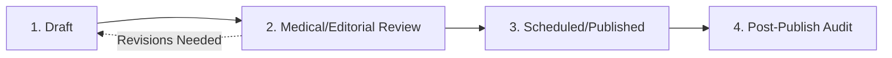

# PharmaInsights Hub: Content Style Guide & Editorial Governance

**Version:** 1.0.0  
**Target:** Editorial Team, Omnichannel Content Creators, and Data Analysts  
**Scope:** Educational healthcare content, data performance articles, and platform copy.  

---

## 1. Editorial Voice & Tone

PharmaInsights Hub maintains a voice that is **evidence-based, objective, academically rigorous, and accessible**. 

### Guiding Principles
- **Evidence-Driven:** Every statement must be supported by methodological reasoning or verifiable synthetic data.
- **Objective & Non-Commercial:** Strictly avoid commercial sales jargon, hyperbolic superlatives ("miracle breakthrough", "guaranteed cure"), or promotional pharmaceutical claims.
- **Clear & Educational:** Deconstruct advanced epidemiological or statistical terminology (e.g., disproportionality, Bayesian shrinkage, Markov attribution) so that multidisciplinary stakeholders (brand managers, medical directors, software engineers) can comprehend the findings without losing technical precision.

---

## 2. Mandatory Disclaimers & Legal Guardrails

### 2.1 The Educational / Not Medical Advice Disclaimer
Every single publication discussing health, therapeutics, adverse events, or drug safety **must** include the standard PharmaInsights Hub Educational Disclaimer prominently above or immediately following the introductory thesis:

> **Educational Disclaimer: Not Medical Advice**  
> *This publication is designed exclusively for educational, data analysis, and informational research purposes. The content does not constitute medical, clinical, pharmacological, or regulatory advice. For clinical inquiries or adverse event reporting, always consult licensed healthcare professionals and official public health authority portals.*

In the WordPress block editor, insert the reusable block pattern: `pharmainsights/disclaimer-notice`.

### 2.2 Synthetic Data Labeling
Whenever charts, KPIs, or data tables are presented, they must carry an explicit visual tag or caption:  
`Notice: Synthetic Demo Data - For Educational & Analytical Demonstration Only`.

---

## 3. Structural & Readability Standards

### 3.1 Heading Hierarchy
- **H1:** Reserved exclusively for the post/page title (rendered automatically by the template).
- **H2:** Main thematic sections. Limit each article to 3–5 H2 sections.
- **H3:** Subsections within an H2. Never jump from H1 directly to H3.
- **Paragraph Length:** Maximum 4 to 5 sentences per paragraph to preserve digital scannability.

### 3.2 Readability & Quantitative Formatting
- **Flesch Reading Ease Target:** 50–65 (aiming for college-level reading ease appropriate for life-sciences professionals).
- **Mathematical Formulas:** Explicitly state the formula components in plain text alongside symbolic notation (e.g., explaining contingency table cells A, B, C, and D for PRR/ROR).
- **Acronyms:** Spell out acronyms on first mention (e.g., *Individual Case Safety Report (ICSR)*, *Healthcare Professional (HCP)*).

---

## 4. Visual Media & Accessibility (WCAG 2.1 AA)

### 4.1 Image Standards
- **Formats:** Scalable Vector Graphics (`.svg`) for diagrams and charts; optimized WebP or compressed JPEG/PNG for photographic assets.
- **Aspect Ratio:** Standard 16:9 ratio (800x450px or 1200x675px) for featured images.
- **Resolution:** Lightweight; target under 100 KB per asset to ensure sub-second rendering.

### 4.2 Alternative Text (Alt Text) Requirements
- Every image must possess descriptive, non-redundant alternative text.
- **Formula:** `[Diagram Type] explaining [Core Concept] with [Key Components/Highlights] for [Audience]`.
- **Bad Alt Text:** `"chart"`, `"image1"`, `"pharmacovigilance graphic"`.
- **Good Alt Text:** `"Pharmacovigilance Signal Detection Workflow diagram showing the progression from spontaneous ICSRs to statistical data mining and multidisciplinary clinical review."`

---

## 5. Publishing Workflow Lifecycle

To maintain content governance and compliance, all content adheres to a 4-stage lifecycle:

1. **Stage 1: Draft (Author / Intern / Analyst)**
   - Author completes research, drafting 600–900 words.
   - Embeds reusable disclaimer pattern and selects category and 2–4 relevant tags.
   - Generates or sources compliant SVG diagram and drafts custom meta description.
2. **Stage 2: Technical & Compliance Review (Editor)**
   - Checks compliance: Zero commercial drug claims, zero real patient data.
   - Verifies heading hierarchy, link integrity, and alt text presence.
   - Validates Yoast SEO readability and keyword optimization score.
3. **Stage 3: Publish or Schedule (Administrator / Editor)**
   - Posts scheduled for optimal Tuesday/Thursday morning distribution (08:00 Asia/Dubai time).
4. **Stage 4: Post-Publish Audit (Weekly Automated Check)**
   - Link checker scripts verify zero 404 broken links.
   - Core Web Vitals audit verifies asset loading performance.
